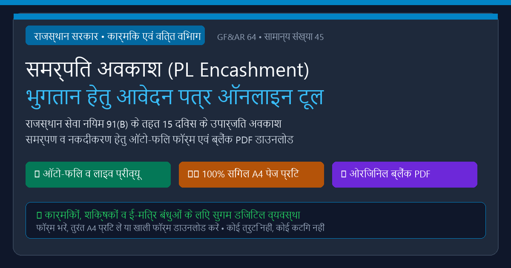
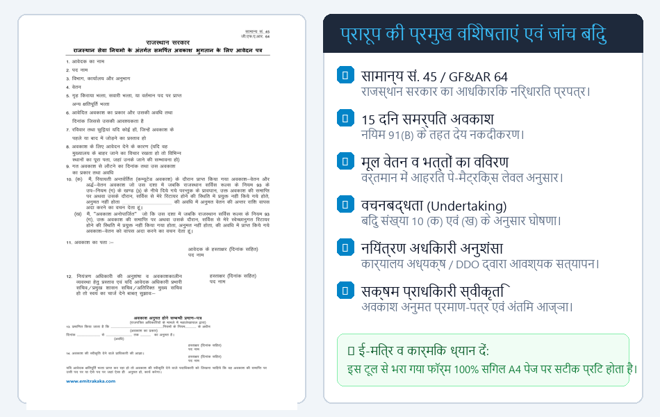
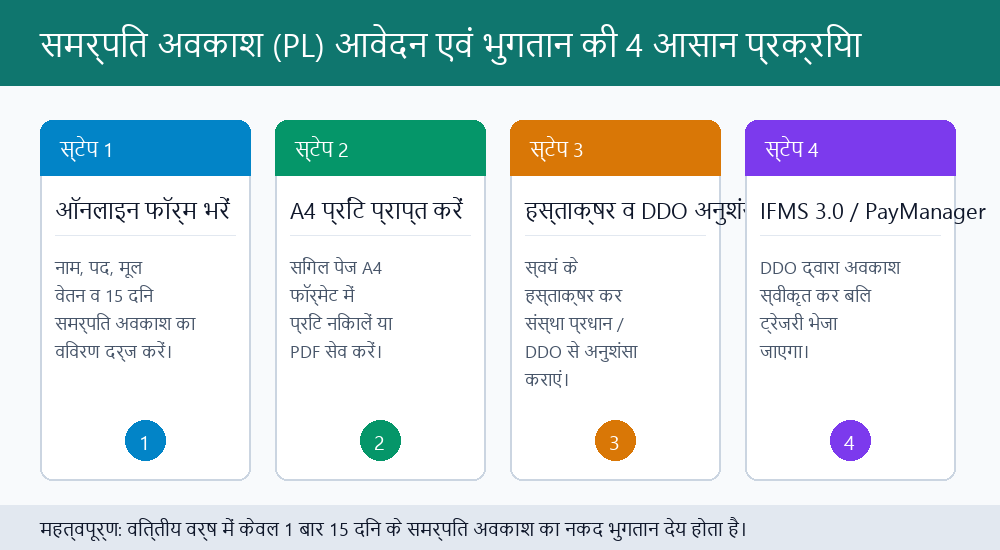
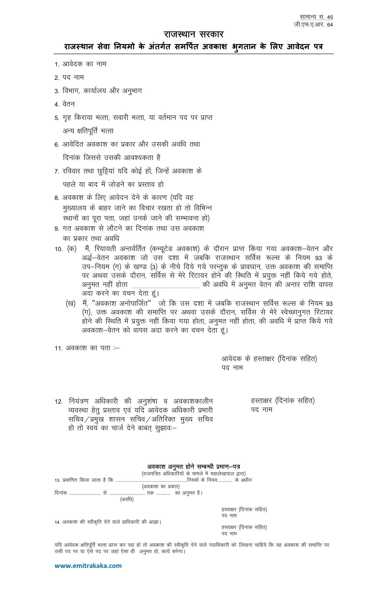

# राजस्थान समर्पित अवकाश (PL) भुगतान आवेदन पत्र (GF&AR 64 / सामान्य सं. 45) : 1-क्लिक ऑनलाइन फॉर्म फिलिंग टूल एवं ओरिजिनल ब्लैंक PDF डाउनलोड

**राम-राम शिक्षक साथियों एवं कार्मिक बंधुओं,**

राजस्थान सरकार के अधीन कार्यरत सभी नियमित राजकीय कर्मचारियों, शिक्षकों एवं कार्मिकों को राजस्थान सेवा नियम (RSR) के **नियम 91(B)** के अनुसार प्रत्येक वित्तीय वर्ष (1 अप्रैल से 31 मार्च) में **15 दिवस के समर्पित अवकाश (Surrender Leave / PL Encashment)** के समर्पण एवं उसके बदले नकद वेतन भुगतान प्राप्त करने का वैधानिक अधिकार होता है।

लेकिन हमारे कई साथी और ई-मित्र संचालक अक्सर एक बड़ी परेशानी से जूझते हैं। बाज़ार में मिलने वाले फॉर्म या इंटरनेट से डाउनलोड किए गए पुराने प्रारूप प्रिंट करते ही 2 पेजों में फैल जाते हैं या उनकी टेबल कट जाती है। नतीजा यह होता है कि संस्था प्रधान या कोषालय (Treasury) द्वारा फॉर्म यह कहकर वापस लौटा दिया जाता है कि *"हस्ताक्षर दूसरे पेज पर अकेले आ रहे हैं, सिंगल पेज में आवेदन प्रस्तुत करें।"*

> **✨ आपकी सुविधा के लिए बनाया गया नया डिजिटल समाधान**
> आपकी इसी समस्या का शत-प्रतिशत स्थायी समाधान करते हुए हमने राजस्थान सरकार के आधिकारिक प्रारूप **(सामान्य संख्या 45 / GF&AR 64)** के अनुसार यह **1-क्लिक ऑनलाइन फॉर्म फिलिंग टूल** तैयार किया है। इस टूल में अपना सामान्य विवरण भरें और तुरंत **100% सिंगल पेज A4 प्रिंट** प्राप्त करें, या सीधे **ओरिजिनल ब्लैंक PDF** डाउनलोड करके हाथ से भरें!

---

## ⚡ लाइव समर्पित अवकाश आवेदन पत्र (Auto-Fill & Print Tool)

> टूल फ़ाइल: `index.html` (Blogger या किसी भी वेबसाइट पर एम्बेड करने हेतु पूर्णतः तैयार)

### मुख्य सुविधाएं:
1. **लाइव ऑटो-अपडेट:** बाईं ओर फ़ील्ड भरते ही दाईं ओर आधिकारिक प्रपत्र में रियल-टाइम प्रविष्टि होती है।
2. **1-क्लिक डेमो डेटा:** नए उपयोगकर्ता '📋 डेमो डेटा भरें' बटन दबाकर तुरंत देख सकते हैं कि फॉर्म कैसा दिखता है।
3. **100% सिंगल A4 पेज प्रिंट:** प्रिंट प्रीव्यू और फिजिकल प्रिंट बिल्कुल एक समान सिंगल पेज पर आता है।
4. **ब्लैंक PDF डाउनलोड:** मूल राजस्थान सरकार प्रपत्र सीधे डाउनलोड करने की सुविधा।

---

## 📥 ओरिजिनल ब्लैंक PDF डाउनलोड करें

यदि आप हाथ से भरकर जमा करना चाहते हैं, तो राजस्थान सरकार के सामान्य संख्या 45 / जी.एफ.ए.आर. 64 का यह मूल खाली प्रपत्र उच्च गुणवत्ता में डाउनलोड करें:

- 📄 **फाइल नाम:** `rajasthan-samarpit-avkas-pl-form.pdf`
- 📏 **साइज:** A4 पोर्ट्रेट प्रिंटेबल
- 💾 **डाउनलोड लिंक:** [rajasthan-samarpit-avkas-pl-form.pdf](rajasthan-samarpit-avkas-pl-form.pdf)

---

---

## 📌 समर्पित अवकाश (PL Encashment) क्या है? नियम एवं पात्रता

राजस्थान सेवा नियम 1951 के नियम 91(B) के अनुसार:
- **पात्र कर्मचारी:** सभी नियमित स्थायी राजकीय कार्मिक, शिक्षक एवं अधिकारी (प्रोबेशन अवधि पूर्ण होने के बाद)।
- **नकद भुगतान की गणना:** `(मूल वेतन + महंगाई भत्ता DA) / 30 × 15` (HRA शामिल नहीं होता)।
- **अवकाश खाते में कटौती:** सेवा पुस्तिका में से 15 उपार्जित अवकाश (PL) काटे जाते हैं।
- **वित्तीय वर्ष की बाध्यता:** 1 अप्रैल से 31 मार्च के दौरान केवल 1 बार ही देय।

---

## ✍️ आवेदन पत्र के सभी 14 बिंदु भरने की बिंदुवार सरल विधि

| क्र. सं. | प्रारूप का विवरण (Field) | क्या और कैसे भरें (Filling Instructions) |
|---|---|---|
| **1** | आवेदक का नाम | सेवा पुस्तिका एवं पे-मैनेजर अनुसार कर्मचारी का पूरा नाम। |
| **2** | पद नाम | वर्तमान पद (वरिष्ठ अध्यापक, अध्यापक L-2, क.स. आदि)। |
| **3** | विभाग, कार्यालय और अनुभाग | वर्तमान पदस्थापन विद्यालय/कार्यालय एवं विभाग का नाम। |
| **4** | वेतन | वर्तमान मूल वेतन (Basic Pay) व पे-मैट्रिक्स लेवल (उदा. ₹ 42,300/- L-11)। |
| **5** | गृह किराया भत्ता व अन्य क्षतिपूर्ति भत्ता | नियमानुसार देय HRA (9% या 18%) अथवा "नियमानुसार देय भत्ते"। |
| **6** | आवेदित अवकाश का प्रकार, अवधि व दिनांक | "समर्पित अवकाश - 15 दिवस, दिनांक 01.04.2026 से"। |
| **7** | रविवार तथा छुट्टियां जोड़ने का प्रस्ताव | समर्पण भुगतान होने से यहाँ "लागू नहीं / शून्य" लिखें। |
| **8** | अवकाश आवेदन का कारण | "नियम 91(B) के तहत 15 दिवस समर्पित अवकाश समर्पण एवं नकद भुगतान बाबत।" |
| **9** | गत अवकाश से लौटने का दिनांक व प्रकार | पिछले वित्तीय वर्ष में लिए गए समर्पित अवकाश का विवरण। |
| **10** | वचनबद्धता (Undertaking क व ख) | कम्यूटेड व अनोपार्जित अवकाश बाबत सरकारी अंडरटेकिंग। |
| **11** | अवकाश का पता एवं हस्ताक्षर | कर्मचारी का पता एवं दाईं ओर हस्ताक्षर व पद। |
| **12** | नियंत्रण अधिकारी की अनुशंसा | संस्था प्रधान / DDO द्वारा अनुशंसा व मुहर। |
| **13** | अवकाश अनुमत प्रमाण-पत्र | कार्यालय द्वारा नियम 91-B के तहत 15 दिन अनुमत का प्रमाणीकरण। |
| **14** | सक्षम प्राधिकारी की स्वीकृति आज्ञा | कार्यालय अध्यक्ष / सक्षम अधिकारी द्वारा औपचारिक स्वीकृति। |

---

## ⚠️ फॉर्म भरते समय इन 5 गलतियों से बचें

1. **2 पेजों पर प्रिंट निकालना:** हमेशा सिंगल A4 शीट पर ही प्रिंट निकालें ताकि साइन अलग न हों।
2. **मूल वेतन में विसंगति:** वर्तमान पे-स्लिप / GA-55 के अनुसार ही नया बेसिक पे दर्ज करें।
3. **प्रोबेशन काल में आवेदन करना:** प्रोबेशनर ट्रेनी को समर्पित अवकाश देय नहीं होता।
4. **पीएल बैलेंस चेक न करना:** अवकाश खाते में पर्याप्त पीएल शेष होना आवश्यक है।
5. **दिनांक व मुहर छूट जाना:** नियंत्रण अधिकारी की मुहर व दिनांक अवश्य लगवाएं।

---

---

## ❓ अक्सर पूछे जाने वाले सवाल (FAQ)

**प्र. 1. क्या समर्पित अवकाश के भुगतान में HRA और DA दोनों मिलते हैं?**  
**उत्तर:** समर्पित अवकाश (15 दिन पीएल) के भुगतान में केवल **मूल वेतन (Basic Pay) और उस पर देय महंगाई भत्ता (DA)** ही मिलता है। इसमें HRA नहीं मिलता।

**प्र. 2. क्या 15 दिन से कम या ज्यादा दिन का समर्पित अवकाश लिया जा सकता है?**  
**उत्तर:** जी नहीं। नियम 91B के तहत वित्तीय वर्ष में नकद भुगतान हेतु ठीक **15 दिन** का ही अवकाश समर्पित किया जा सकता है।

**प्र. 3. फॉर्म भरने के बाद बिल कैसे पास होगा?**  
**उत्तर:** यह फॉर्म भरकर DDO को दें। सेवा पुस्तिका में कटौती दर्ज होगी और PayManager / IFMS 3.0 पर बिल बनाकर ट्रेजरी भेजा जाएगा।

**प्र. 4. क्या यह प्रारूप सभी सरकारी विभागों में मान्य है?**  
**उत्तर:** जी हाँ, यह राजस्थान सरकार के वित्त विभाग द्वारा निर्धारित आधिकारिक **सामान्य संख्या 45 / जी.एफ.ए.आर. 64** है और सभी विभागों में पूर्णतः मान्य है।
